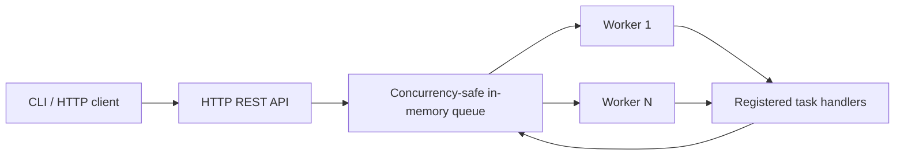

# Reliable Workflows Lab

**A reproducible backend-engineering portfolio project about job queues, concurrency, retries, and failure recovery.**

> **Status: Phase 1 prototype, not production-ready.** The API and worker pool run in one process and store jobs in memory. Restarting the process **loses all jobs and idempotency keys**. PostgreSQL durability is explicitly reserved for Phase 2.

## What works today

- Submit `echo`, `sum`, or deliberately failing demo jobs over HTTP.
- Replay an `Idempotency-Key` without scheduling a duplicate; reject conflicting reuse with HTTP 409.
- Atomically lease a due job to one worker at a time; protect completion against stale lease tokens.
- Apply bounded retries with exponential backoff; move exhausted jobs to `dead`.
- Recover expired worker leases (at-least-once *attempt* semantics within one process lifetime).
- Inspect jobs, recent submissions, and state totals through a JSON API.
- Test concurrent claims, idempotent submission races, lease expiration, stale acknowledgment, retries, and malformed inputs using only Go's standard library.

## Architecture (Phase 1)



Go's `sync.Mutex` serializes state transitions in Phase 1. Worker lease tokens fence out stale completions. The design is intentionally independent of a particular queue broker; [ADR 0001](docs/ADR-0001-queue-semantics.md) explains the trade-offs.

### Job lifecycle

```text
  submit -> queued -> running -> succeeded
               ^        |
               |        +---- failure / lease expiry -> queued (after backoff)
               |                                     or -> dead (attempts exhausted)
               +-------------------------------------+
```

The implementation provides at-least-once **execution attempts** during a running process, not exactly-once side effects. A worker can perform an external action and lose its lease before acknowledging completion. Consumers must make external effects idempotent. See [limitations](#limitations-and-security).

## Quick start

Install a supported Go toolchain (currently Go 1.27.x recommended; the source also compiles with Go 1.23). No database, Docker, or API keys are needed for this first phase.

```bash
go run ./cmd/server
# In a second terminal:
curl -s http://127.0.0.1:8080/healthz
```

Create an echo job:

```bash
curl -i -X POST http://127.0.0.1:8080/v1/jobs \
  -H 'Content-Type: application/json' \
  -H 'Idempotency-Key: demo-001' \
  -d '{"kind":"echo","payload":{"message":"hello"}}'
```

Submit the same request with the same key: the API returns **200** with the original job instead of creating a new one. A new job returns **201** and a `Location: /v1/jobs/<id>` response header. Reusing the key with a different request returns **409**.

Create a summation job:

```bash
curl -s -X POST http://127.0.0.1:8080/v1/jobs \
  -H 'Content-Type: application/json' \
  -d '{"kind":"sum","payload":{"numbers":[1,2,3.25]},"max_attempts":3}'
```

Wait briefly, then inspect the returned ID:

```bash
curl -s http://127.0.0.1:8080/v1/jobs/YOUR_JOB_ID
curl -s 'http://127.0.0.1:8080/v1/jobs?limit=10'
curl -s http://127.0.0.1:8080/v1/stats
```

To demonstrate retry and dead-letter behavior, submit `{"kind":"fail","payload":{},"max_attempts":2}` and inspect the job after a few seconds.

## HTTP API

| Method | Path | Result |
|---|---|---|
| `GET` | `/healthz` | Process health, not durability |
| `POST` | `/v1/jobs` | Create job (201), replay (200), or conflict (409) |
| `GET` | `/v1/jobs/{id}` | Current job state (200) or missing (404) |
| `GET` | `/v1/jobs?limit=20` | Up to 100 newest jobs |
| `GET` | `/v1/stats` | Counts by job state |

Job request shape:

```json
{
  "kind": "echo",
  "payload": {"message": "hello"},
  "max_attempts": 3
}
```

`max_attempts` defaults to 3 (range 1–8). Payloads are capped at 64 KiB. This is a demo execution environment: **only three registered tasks are accepted**, and it never executes user-supplied shell commands or code.

## Verification

```bash
go test ./...
go test -race -count=1 ./...
go vet ./...
go test -cover ./...
```

A manual end-to-end exercise is available via `bash scripts/smoke.sh`. The race detector and test suite were run in the authoring environment. There is no claim yet of cloud deployment, persistence under restart, or load-tested throughput.

## Repo layout

```text
cmd/server/main.go           HTTP server, workers, graceful signal handling
internal/httpapi/api.go      REST API, bounded request parsing
internal/jobs/queue.go       State machine, leases, retries, deduplication
internal/jobs/processor.go   Registered task handlers, worker loops
internal/**/*_test.go        Race, API, and state-machine tests
scripts/smoke.sh             End-to-end HTTP smoke test
docs/ADR-0001-queue-semantics.md
docs/PHASES.md
docs/INTERVIEW_GUIDE.md
docs/PRODUCT_BRIEF.md
```

## Limitations and security

- **No persistence:** all state disappears on restart. This is the highest-priority gap.
- **No authentication, tenant separation, or rate limits.** The HTTP server binds to `127.0.0.1:8080` by default. Do **not** expose this API publicly.
- **No multi-process coordination:** all concurrency guarantees apply only to this process. Multiple server instances would have independent queues.
- **No exactly-once side effects:** a worker may run twice after a crash or lease expiration; external consumers need idempotency.
- **No lease renewal or heartbeat:** tasks exceeding the lease duration can be retried. The default processing timeout is 5s and the lease is 10s.
- **Unbounded in-memory history:** not suitable for long-running or high-volume production use.
- **No real DLQ replay workflow, metrics export, distributed tracing, or benchmark claim.** These are upcoming phases.

## Roadmap and interview narrative

See [PHASES.md](docs/PHASES.md) for milestones and acceptance criteria, and [INTERVIEW_GUIDE.md](docs/INTERVIEW_GUIDE.md) for engineering decisions, failure modes, and questions to rehearse. This repository is intentionally structured to demonstrate **software fundamentals before infrastructure complexity**.

## License

MIT — see [LICENSE](LICENSE).
